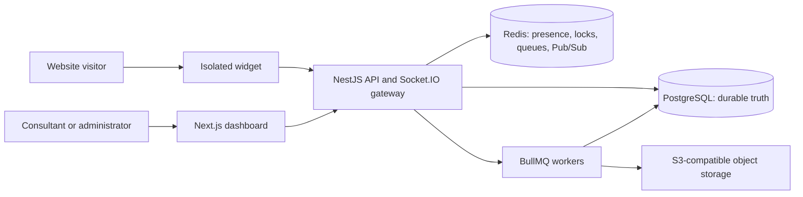
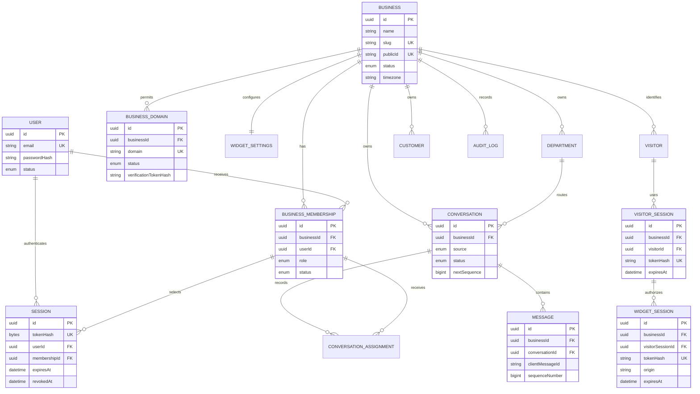
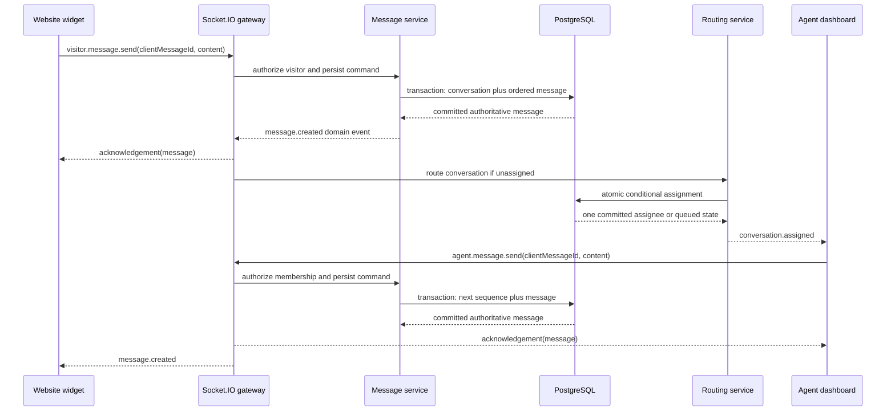

# BizChat architecture

## System shape

BizChat is a multi-tenant conversation platform. PostgreSQL is the source of truth for durable
business data, Redis owns ephemeral coordination state, Socket.IO carries live events, and BullMQ
will run retryable background work. The widget and dashboard are untrusted clients of a
tenant-aware API; neither establishes authorization by presenting a business ID.

Repository boundaries:

- `apps/api`: NestJS HTTP and real-time backend.
- `apps/web`: Next.js business dashboard.
- `apps/widget`: native Shadow DOM website widget with durable conversation messaging.
- `packages/types`: transport-safe shared types.
- `packages/validation`: Zod request contracts shared by clients and API.

## Tenant and authorization boundary

A `User` is a global login identity. A `BusinessMembership` grants a role in one business. An
authenticated session selects one membership and therefore one `businessId`. Protected services
receive this server-derived context and query tenant-owned rows with both object ID and
`businessId`. Client-supplied tenant IDs are never authorization evidence.

Opaque tokens come from a cryptographically secure random source. Only a keyed SHA-256 digest is
stored. The browser receives the token in an HttpOnly, SameSite cookie; logout and administrative
revocation invalidate the durable session.

## Widget trust boundary

The embed contains only a safe `pub_...` business identifier. Bootstrap succeeds only when the
browser origin's normalized hostname has a `VERIFIED` domain record for that business. A persistent
opaque visitor token identifies the same browser without fingerprinting. Bootstrap exchanges it
for a short-lived, origin-bound widget-session token used during the Socket.IO handshake. The
gateway selects the session room server-side; clients cannot join arbitrary rooms.

## Durable conversation model

Conversation, message, assignment, queue, timeline, and recovery state are durable PostgreSQL
records. Redis is never the sole owner of conversation state.

## WebSocket message flow

Durable actions are acknowledged only after database commit; broadcasts follow the commit.

## Failure and scaling rules

- PostgreSQL failure makes durable commands fail without a success acknowledgement.
- Redis failure degrades presence/routing but never erases messages.
- Message retry reuses its client message ID and returns the existing row.
- Sequence allocation and assignment are transactional database operations.
- Socket rooms are tenant-scoped and participant-authorized; a room name grants no access.
- Horizontal API instances use the Socket.IO Redis adapter; a domain event emitted on one node can
  reach sockets connected to another node.

## Reconnection and durable recovery

Both clients reconnect with bounded exponential delay. After authentication, the widget resumes its
stored conversation and requests every message after its last committed sequence. The consultant
dashboard resubscribes every open tab with that tab's last committed sequence. Catch-up continues in
bounded pages until the sequence gap is closed, then delivery/read receipts are refreshed. Pending
sends keep their original `clientMessageId`, so retrying after an acknowledgement timeout returns the
existing message instead of inserting a duplicate.

Assigned consultant disconnects are recorded on the conversation with `agentDisconnectedAt` and a
tenant-configured `reassignmentDueAt`. Reconnection clears the deadline and restores the same
assignment. After expiry, a transaction-scoped advisory lock protects release of the current
assignment, participant access is closed, a durable `REASSIGNED` event and customer-safe system
message are appended, and the same conversation is routed with assignment type `REASSIGNMENT`.
Transient routing failures store the next retry deadline, attempt count, and bounded error summary in
PostgreSQL with exponential backoff.

A periodic, overlap-safe recovery sweep reconstructs missing queue entries from `QUEUED`
conversations and retries unassigned `NEW`/`QUEUED` conversations. This makes API restarts and Redis
key loss recoverable without reconstructing durable state from ephemeral data.

Redis key patterns used by the realtime layer are deliberately tenant-scoped and TTL-bound:

- `presence:agent:{businessId}:{agentProfileId}:sockets`
- `presence:agent:{businessId}:{agentProfileId}:state`
- `presence:visitor:{businessId}:{visitorId}:sockets`
- `typing:{conversationId}:{participantType}:{participantId}`

Message content, conversation history, assignments, and durable queue state are not stored in Redis.

## Consultant real-time state

`AgentProfile` stores durable configuration such as capacity and routing preference. Redis sorted-set
leases track each active socket with an expiry score; the final expired/disconnected socket makes the
agent or visitor offline. Short-lived typing keys and payload expiry prevent stuck indicators. The
authenticated `/agent` gateway derives its tenant from the dashboard session and authorizes every
conversation subscription before joining a room.
