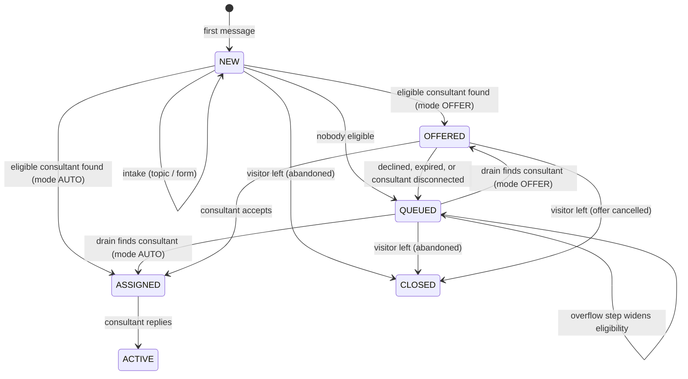
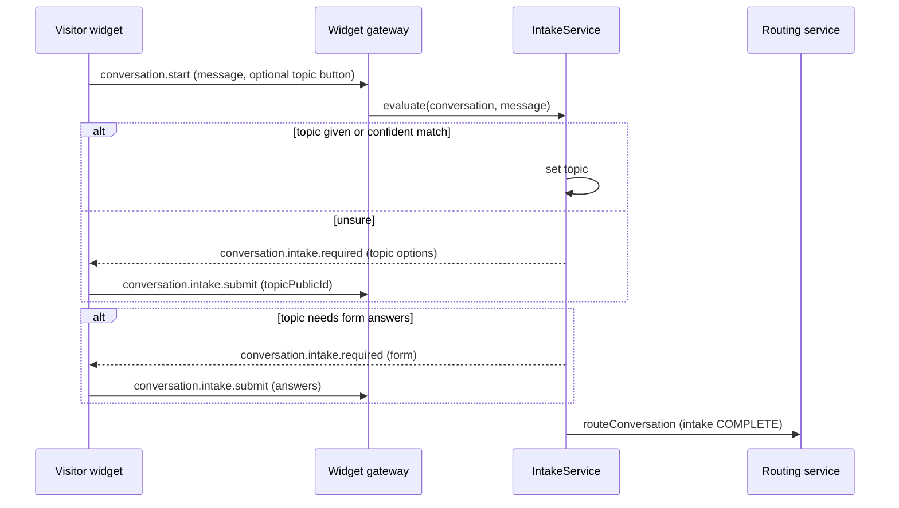

# Phase B: intent routing, offers, overflow, and pre-chat intake

Status: **B1 implemented; B2-B5 proposed**. This document defines the design for Phase B. It builds
on the Phase A routing changes (ordered, coalesced queue drains; single-instance reliability sweep;
queue abandonment).

B1 as built:

- `skills`, `agent_skills`, and `routing_settings` (with `routingStrategy` only; later slices add
  their columns). Skills are managed on **Dashboard → Routing**, proficiency on **Dashboard → Users**.
- A conversation carries its requirement directly as `requiredSkillId` and
  `requiredSkillMinProficiency`. Topics set these in B3; until then nothing in the product sets them,
  so B1 changes no routing outcome on its own.
- A requirement on a disabled skill is ignored, so disabling a skill never strands a queue.
- Changing a consultant's skills does not trigger an immediate drain; the reliability sweep drains
  within one interval.

## Goal

A visitor types what they need. BizChat works out the topic, collects any details the business
requires, and connects the visitor to an available consultant who has the right skill. The
consultant must accept the chat within a time limit, otherwise it moves to the next consultant. If
nobody suitable is free, the search widens step by step instead of leaving the visitor waiting
forever.

Today the first message is stored but not used for routing; routing uses only an optional
department picker, assigns directly without acceptance, and never widens the search.

## Principles

- **Existing behaviour is the default.** A tenant with no topics, no forms, and assignment mode
  `AUTO` behaves exactly as today. Every Phase B feature is opted into per tenant.
- **PostgreSQL stays authoritative.** Offers, intake state, overflow levels, and timers are durable
  columns. Redis only coordinates (presence, drain locks, sweep lease).
- **Every state change is a conditional update.** Accept, decline, expiry, overflow, and abandonment
  each update only when the row is still in the expected state, so concurrent actors produce exactly
  one winner, as Phase 5 assignment already does.
- **Deterministic first.** The shipped classifier is a keyword and phrase matcher that a business
  can understand and tune. A language-model classifier is an optional later plug-in, not a
  dependency.
- **No tenant-supplied regular expressions on the server.** Field formats use a constrained mask
  language to avoid catastrophic-backtracking attacks.

## Concepts

| Concept       | Meaning                                                                                                                                                                                                                                        |
| ------------- | ---------------------------------------------------------------------------------------------------------------------------------------------------------------------------------------------------------------------------------------------- |
| Topic         | A reason for contacting the business, such as "Company registration". It names the department that owns it, an optional required skill, a default priority, matching keywords and examples, an optional pre-chat form, and an overflow policy. |
| Skill         | A capability a consultant has, with proficiency 1-5. Departments stay the team and queue boundary; skills select the right people inside or across teams.                                                                                      |
| Intake        | The steps between the first message and routing: classify the topic, confirm it when unsure, and collect form answers.                                                                                                                         |
| Offer         | A time-limited proposal of a conversation to one consultant, who accepts or declines.                                                                                                                                                          |
| Overflow      | Timed steps that widen who may take a queued conversation.                                                                                                                                                                                     |
| Routing cycle | The attempts to place one conversation. Consultants who declined or missed it are excluded for a while within the cycle.                                                                                                                       |

## Conversation lifecycle

Two additions to the conversation model:

- `intakeStatus`: `NOT_REQUIRED` (default; existing and integration conversations), `AWAITING_TOPIC`,
  `AWAITING_FORM`, `COMPLETE`. Routing considers a conversation only when intake is `NOT_REQUIRED`
  or `COMPLETE`.
- Conversation status `OFFERED`, between `NEW`/`QUEUED` and `ASSIGNED`.

`OFFERED` consumes capacity (it joins `CAPACITY_STATUSES`), so a consultant is never offered more
chats than they can take. `ASSIGNED` keeps its current meaning: accepted, not yet replied to.

## 1. Topics and the intake classifier

### Topic definition

Per tenant, managed in **Dashboard → Routing → Topics**:

- name, description, public ID, status, sort order
- owning department; optional required skill and minimum proficiency
- default priority
- keywords and phrases (each with an optional weight), negative keywords, and example messages
- `showAsQuickReply`: offered as a button in the widget welcome panel and clarification prompts
- optional pre-chat form
- overflow steps and maximum wait (section 4)

One topic per tenant is marked default and receives anything that cannot be classified.

### Intake flow

1. The first message creates the conversation and message as today.
2. `IntakeService` picks the topic from, in order: a topic button the visitor pressed; a topic sent by
   an integration; the legacy department picker (mapped to that department's default topic); the
   classifier.
3. A confident match sets the topic. A middling match sets the topic and shows the visitor a
   "Not right? Choose another topic" control. A weak or absent match moves intake to
   `AWAITING_TOPIC` and sends the top three topics plus "Something else".
4. If no choice arrives within `topicPromptTimeoutSeconds` (default 60) while the visitor is still
   connected, intake falls back to the default topic so nobody waits on an unanswered prompt.
5. If the topic (or the tenant default) has a form whose required answers are missing, intake moves
   to `AWAITING_FORM` (section 2).
6. Intake becomes `COMPLETE`, the conversation takes the topic's department and priority, and routing
   runs.

Supervisors see intake-stage conversations in the inbox, marked as not yet routable. The Phase A
abandonment rule applies unchanged, so a visitor who leaves during intake is closed out.

### Keyword classifier

Deterministic and per tenant:

1. **Normalise:** Unicode NFKD, strip diacritics, lowercase, replace non-alphanumerics with spaces,
   collapse whitespace. Remove a small stop-word list for the tenant locale.
2. **Match:** tokens are compared after light suffix stemming. Tokens of five or more characters also
   match with one typo (Damerau-Levenshtein distance 1). Phrases match on consecutive stemmed tokens.
3. **Score each topic:** sum of matched keyword weights (default 1, phrases default 2), plus 0.5 × the
   best token overlap with the topic's example messages. Any negative keyword zeroes that topic.
4. **Confidence:** with the top two scores `s1 ≥ s2`, confidence is `s1 / (s1 + s2 + 1)`. The `+ 1`
   keeps a single weak hit from looking certain. Zero `s1` means no match.
5. **Decide:** confidence ≥ 0.6 routes directly; 0.35 to 0.6 routes and offers the change control;
   below 0.35 asks the visitor. Thresholds are tenant settings within fixed bounds, and these
   defaults are starting points to tune against recorded classifications.

Each tenant's compiled matcher is cached in memory and keyed by a topic-catalogue version number, so
an edit invalidates every API instance's cache on its next use without a broadcast.

The topic editor includes **Test a message**, which shows the scores and the decision for typed text
so a business can tune keywords before going live.

Every decision is stored in `conversation_classifications` (topic, method, confidence, top
candidates, whether the visitor confirmed or changed it). Phase 10 analytics and keyword tuning use
this record.

### Optional language-model classifier (later)

A pluggable `IntentClassifier` interface allows a model-based classifier per tenant, off by default.
It would receive only the message text, after removing email addresses and long digit sequences,
together with topic names and descriptions; return strict JSON; and fall back to the keyword
classifier after a 2-second timeout. Because message text leaves BizChat, it needs tenant opt-in
and a visitor privacy notice under POPIA. It is not part of the first Phase B release.

## 2. Pre-chat form

### Form definition

Managed in **Dashboard → Routing → Forms**. A form has a name, a version, optional consent text
(the visitor must tick it), and up to 10 fields:

| Property      | Values                                                                                                                                                                |
| ------------- | --------------------------------------------------------------------------------------------------------------------------------------------------------------------- |
| `type`        | `TEXT`, `EMAIL`, `PHONE`, `SELECT`, `REFERENCE`                                                                                                                       |
| `required`    | boolean                                                                                                                                                               |
| `maxLength`   | up to 200                                                                                                                                                             |
| `options`     | for `SELECT`, up to 20                                                                                                                                                |
| `mask`        | for `REFERENCE`: `#` digit, `A` letter, `*` letter or digit; any other character must match literally. For example, `####/######/##` describes a registration number. |
| `prefillFrom` | an identity claim (see below)                                                                                                                                         |

The server builds the validation schema from the stored definition. Masks are compiled to a linear
character-by-character check, never to a regular expression, so a tenant cannot submit a pattern
that hangs the API.

### When the form appears

A tenant setting `intakeFormTiming`:

- `AFTER_TOPIC` (recommended default): the form shown depends on the topic. For example, a
  registration topic can ask for a registration number while a general enquiry asks only for a name.
- `BEFORE_CHAT`: the tenant default form appears in the welcome panel and its answers travel with
  `conversation.start`, for businesses that must identify every visitor before the conversation
  starts.

### Storage and access

`conversation_intakes` stores one row per conversation: form ID and version, answers (JSONB),
consent time, and submission time. Answers appear in the consultant's context panel and in the
offer card. They are excluded from webhooks and the integration API unless a key has a new
`intake:read` scope. Retention and deletion follow the Phase D policy work.

Identified customers (signed identity from the integration API) skip fields whose `prefillFrom`
claim is present. Identity proofs currently carry only an external ID, so name and email claims
require a small extension to the identity proof format.

Guidance in the form editor: collect only what the consultant needs, and avoid national ID numbers
unless the service requires them.

## 3. Skills and matching

New tables `skills` and `agent_skills` (proficiency 1-5), managed on **Dashboard → Consultants**.

A conversation's eligibility at overflow level `L` is the existing filters (active, routing enabled,
online, below capacity) and:

- membership of a department allowed at level `L`
- the topic's required skill at the minimum proficiency, unless level `L` relaxes it
- not excluded in this routing cycle (section 5)

Candidate ordering extends `orderCandidates`:

1. eligible previous consultant (existing preference)
2. tenant `routingStrategy`:
   - `LEAST_BUSY` (default): fewest active chats, then higher proficiency
   - `BEST_SKILL`: higher proficiency, then fewest active chats
3. oldest `lastAssignedAt`, then ID

The Phase A `DrainScopeTracker` changes its key from department to an **eligibility signature** (the
allowed departments, the skill and minimum proficiency, and the overflow level). The rule that an
unconstrained miss exhausts every scope still holds. A conversation with exclusions never marks
its signature exhausted, because a consultant excluded for it may suit the next conversation.

## 4. Overflow and maximum wait

Each topic has an ordered list of overflow steps, for example:

| Step | After waiting | Effect                                      |
| ---- | ------------- | ------------------------------------------- |
| 1    | 60 s          | also allow the General Enquiries department |
| 2    | 180 s         | relax the skill requirement                 |
| 3    | 300 s         | any online consultant                       |

Queue entries gain `overflowLevel` and `nextOverflowAt`. The reliability sweep (single instance,
from Phase A) advances due entries with a conditional increment, records an `OVERFLOWED` timeline
event, and drains that tenant. Advancing a level starts a new routing cycle, which clears
exclusions.

Drains already read the tenant queue ordered by priority, then wait time. An overflowed conversation
therefore competes fairly by wait time with conversations native to the department it overflowed
into.

The queue position shown to the visitor stays relative to the topic's own queue. Once a
conversation has overflowed, the position is approximate, and the widget says "You're next" or
"N ahead" rather than promising a time.

**Maximum wait.** Each topic has an optional `maxWaitSeconds`. When it passes, the visitor is told
waits are long and offered: keep waiting, or leave contact details for a follow-up. A follow-up
conversation stays queued with `followUpRequested` and the contact details, and is excluded from
abandonment because the visitor intends to leave. Replying to follow-ups by email needs outbound
conversation email, which belongs to a later phase. Phase B only captures and flags them.

## 5. Offer and accept

### Settings

A new `routing_settings` table, one row per tenant:

| Setting                     | Default       | Range or values              |
| --------------------------- | ------------- | ---------------------------- |
| `assignmentMode`            | `AUTO`        | `AUTO`, `OFFER`              |
| `offerTimeoutSeconds`       | 30            | 10-120                       |
| `missedOffersBeforeAway`    | 2             | 0 (off) to 10                |
| `exclusionSeconds`          | 300           | 60-3600                      |
| `routingStrategy`           | `LEAST_BUSY`  | `LEAST_BUSY`, `BEST_SKILL`   |
| `intakeFormTiming`          | `AFTER_TOPIC` | `AFTER_TOPIC`, `BEFORE_CHAT` |
| `topicPromptTimeoutSeconds` | 60            | 15-600                       |
| classifier thresholds       | 0.6 / 0.35    | bounded                      |

Routing settings currently stored on `widget_settings` (previous-consultant preference, disconnect
grace) stay where they are, to avoid a data migration.

### Offering

In `OFFER` mode, the existing claim transaction (same advisory lock and capacity re-check) writes:

- conversation: `status = OFFERED`, `assignedAgentMembershipId` = the consultant (reserves capacity),
  `currentOfferId`, `offerExpiresAt`
- `conversation_offers` row: conversation, agent profile, offered time, expiry, outcome (empty)
- the agent's `lastAssignedAt`, so fairness treats an offer as a turn and a decliner is not
  immediately offered the next chat
- an `OFFERED` timeline event, with no visitor-visible system message

The consultant receives `conversation.offered` with the offer ID, expiry, topic, the first message,
and intake answers, but does not join the conversation room until they accept. The widget shows
"Connecting you with a consultant" without a name.

### Accepting

`offer.accept` runs one transaction:

1. Conditional update: conversation ID matches, `status = OFFERED`, `currentOfferId` = the offer,
   `offerExpiresAt > now()`, assigned to the caller → `ASSIGNED`, `assignedAt = now()`.
2. If no row changed, return `OFFER_NO_LONGER_AVAILABLE`.
3. Otherwise: set the offer outcome to `ACCEPTED`, create the `ConversationAssignment` record, add
   the participant, record an `ASSIGNED` event, and send the visitor the existing
   "Conversation assigned to …" system message.

### Declining, expiry, and disconnects

Decline, expiry, and a consultant disconnecting (no grace period while an offer is pending) share
one release path:

- conditional update from `OFFERED` with the same offer ID back to `QUEUED`; clear the assignment
  and offer fields; reactivate the queue entry
- offer outcome `DECLINED`, `EXPIRED`, or `CANCELLED`
- route again immediately, excluding that consultant

Expiry has two triggers, and both use the conditional update, so only one acts. The instance that
made the offer sets a timer for `offerExpiresAt` plus 250 ms. The reliability sweep is the backstop
and processes due offers oldest first, so the worst-case delay is one sweep interval if that
instance dies.

**Missed offers.** After `missedOffersBeforeAway` consecutive `EXPIRED` offers, the consultant's
presence is set to `AWAY` through the existing presence path, they are told why, and accepting any
offer resets the count. This stops an absent consultant who left a tab open from being offered
every chat.

**Exclusions.** Consultants with a `DECLINED` or `EXPIRED` offer for this conversation within
`exclusionSeconds`, in the current routing cycle, are not eligible. If that leaves nobody, the
conversation queues and becomes offerable again when exclusions lapse or an overflow step starts a
new cycle.

**Abandonment.** Phase A abandonment extends to `OFFERED`: if the visitor leaves, the offer is
cancelled, the consultant's offer card is withdrawn, and the conversation closes.

## Data model changes

All additive. New enum values are added in their own migration files, because PostgreSQL cannot use
an enum value added in the same transaction.

| Change                                                         | Detail                                                                                                                    |
| -------------------------------------------------------------- | ------------------------------------------------------------------------------------------------------------------------- |
| `ConversationStatus` + `OFFERED`                               | joins `CAPACITY_STATUSES`                                                                                                 |
| `ConversationEventType` + `OFFERED`, `OVERFLOWED`, `TOPIC_SET` | timeline and analytics                                                                                                    |
| `conversations`                                                | `topicId`, `intakeStatus`, `currentOfferId`, `offerExpiresAt`, `followUpRequested`; index on (`status`, `offerExpiresAt`) |
| `conversation_queue_entries`                                   | `overflowLevel`, `nextOverflowAt`, `routingCycle`; index on (`nextOverflowAt`) where unassigned                           |
| `topics`, `topic_keywords`, `topic_examples`                   | catalogue; `businesses.topicCatalogVersion` for cache invalidation                                                        |
| `skills`, `agent_skills`                                       | proficiency 1-5                                                                                                           |
| `intake_forms`                                                 | versioned field definitions                                                                                               |
| `conversation_intakes`                                         | answers and consent                                                                                                       |
| `conversation_classifications`                                 | decision record                                                                                                           |
| `conversation_offers`                                          | offer history; index on (`conversationId`, `agentProfileId`, `respondedAt`)                                               |
| `agent_profiles`                                               | `missedOfferStreak`                                                                                                       |
| `routing_settings`                                             | per-tenant settings above                                                                                                 |

This release also adds the conversation index Phase A identified as missing for the abandonment scan.

## Realtime and API contract changes

Widget namespace:

- server → client `conversation.intake.required`: `{ conversationId, step: 'TOPIC' | 'FORM', topics?, form? }`
- client → server `conversation.intake.submit`: `{ conversationId, topicPublicId?, answers?, consent? }`
- `conversation.start` accepts optional `topicPublicId` and, for `BEFORE_CHAT`, `answers`
- `conversation.routed` gains outcome `OFFERED`
- server → client `conversation.wait.options` at maximum wait; client → server
  `conversation.followup.request` with contact details
- bootstrap configuration includes quick-reply topics and the `BEFORE_CHAT` form when used

Agent namespace:

- server → client `conversation.offered` and `conversation.offer.withdrawn`
- client → server `offer.accept` and `offer.decline` (`{ offerId, reason? }`)
- presence events carry the reason when a consultant is set away for missed offers

Integration API:

- `POST /conversations` accepts `topicPublicId` and `intake` answers; without a topic, the subject
  and first message are classified
- new scope `intake:read` for intake answers
- webhooks for offers and overflow belong to Phase C

## Dashboard changes

- **Routing → Topics:** catalogue editor with Test a message
- **Routing → Forms:** field editor with a preview
- **Settings → Routing:** the `routing_settings` values
- **Consultants:** skills and proficiency
- **Inbox:** offer card with countdown, Accept and Decline, and an alert sound; topic and intake
  answers in the context panel; supervisor filters for intake, offered, overflowed, and follow-up
  conversations

## Delivery slices

Each slice ships with unit tests, HTTP integration tests, and a real-stack smoke script, and leaves
existing tenants unchanged.

| Slice | Scope                                                                                    | Key tests                                                                                                     |
| ----- | ---------------------------------------------------------------------------------------- | ------------------------------------------------------------------------------------------------------------- |
| B1    | Skills, `routing_settings`, eligibility signatures, candidate ordering                   | skill filtering and ordering; drain exhaustion by signature; unchanged behaviour with no skills               |
| B2    | Offer and accept, expiry timers and sweep, missed offers to away, inbox offer card       | concurrent accept and expiry produce one winner; decline re-offers to the next consultant; disconnect cancels |
| B3    | Topics, keyword classifier, clarification prompt, Test a message, classification records | classifier fixtures (typos, phrases, negatives, ties); prompt timeout falls back to default topic             |
| B4    | Pre-chat forms, both timings, masks, consent, `intake:read`                              | mask validation including hostile input; prefill skips; answers hidden from webhooks without scope            |
| B5    | Overflow steps, maximum wait, follow-up capture                                          | level advance at time; cycle clears exclusions; follow-ups excluded from abandonment                          |

B1 and B2 do not depend on topics, so offer and accept can ship before the classifier.

## Decisions (accepted 2026-10-24)

1. **Default assignment mode:** `OFFER` for tenants created after B2 ships; existing tenants stay on
   `AUTO` until they opt in.
2. **Missed offers:** consultants are set away after 2 consecutive missed offers by default.
3. **Form timing:** `AFTER_TOPIC` by default.
4. **Outside business hours:** skip intake routing, show the offline message, and capture contact
   details as a follow-up.
5. **Language-model classifier:** deferred to a later release, tenant opt-in only, with the redaction
   and privacy-notice requirements above. Phase B ships the keyword classifier alone.
6. **Languages:** per-tenant keywords and synonyms are enough for launch; no translation or
   language detection.

## Out of scope for Phase B

- Estimated wait time (needs Phase 10 handle-time data)
- Email replies to follow-up conversations
- Webhooks for offers, overflow, and intake (Phase C)
- Retention and deletion of intake answers (Phase D)
